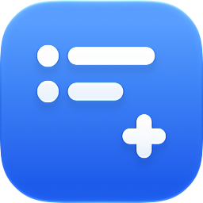

<div align="center">
  <h1>
    <br>
    Better Reminders Widget
  </h1>
  <p>A Lock Screen widget for iPhone that shows today's reminders without any checkboxes,<br>so nothing gets ticked off by accident.</p>
</div>

---

## What it shows
- Incomplete reminders that are due today or overdue, from all lists
- Up to 3 reminders, soonest first, with overdue ones marked `!` instead of `•`
- A "Today" header when there's room, and "No reminders" when you're all caught up
- Text shrinks automatically when there are more reminders or long titles

Tapping the widget opens Apple's Reminders app.

## Setup
1. Open `Better Reminders Widget.xcodeproj` in Xcode and run the **Better Reminders Widget** scheme on your iPhone.
2. In the app, tap **Grant Access** to allow Reminders access.
3. Long-press the Lock Screen → **Customize** → **Lock Screen**, then add **Safe Reminders** under the clock.

## Notes
- The widget refreshes about every 15 minutes (iOS decides exactly when). Opening the app refreshes it right away.
- Widgets can only open their own app, so taps go through this app, which immediately opens Reminders. You may see it flash briefly.
- Opening Reminders relies on the undocumented `x-apple-reminderkit://` URL scheme, which Apple could change.
- Requires iOS 27.2 or later.

## App icon
The icon lives in `Better Reminders Widget/SafeReminders.icon` (an Icon Composer bundle). After changing it, re-render the README image:

```sh
"/Applications/Xcode.app/Contents/Applications/Icon Composer.app/Contents/Executables/ictool" \
  "Better Reminders Widget/SafeReminders.icon" --export-preview iOS Light 256 256 1 docs/icon.png
```
